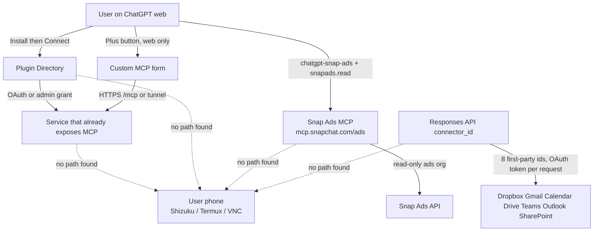
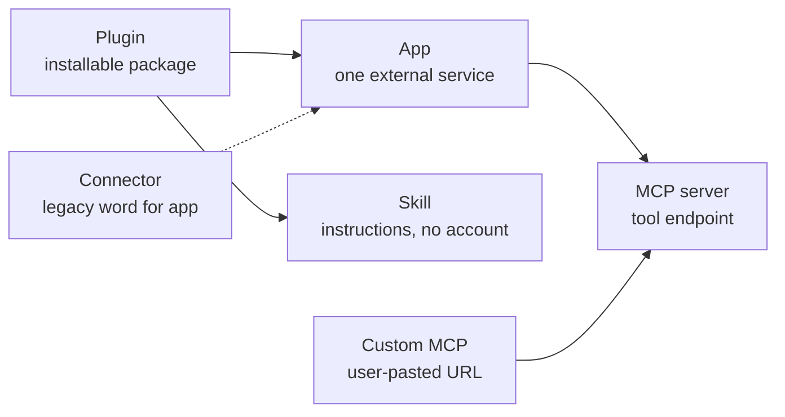

# Build spec handoff — OpenAI plugins, connectors, and “Snap Connect”

Date: 2026-11-13
Status: research export. Not a device receipt. Not an executed connection.
Audience: next builder.

## Verdict

There is no OpenAI product named Snap Connect, and nothing in the public plugin or connector surface that attaches ChatGPT to an arbitrary app or to a phone.

Two official attach paths exist:

1. **Plugin Directory.** A plugin is the installable package. An app inside it is one external-service integration, almost always an MCP server. Connect is OAuth or an admin-managed grant. Install does not authorize.
2. **Custom MCP.** Paste a public HTTPS MCP URL, or a Secure MCP Tunnel id, under Plugins → + → Add custom MCP server. This is the only “any desired app” path, and only if that app already speaks MCP. It is web-only. Official Help (reviewed 2026-11-13) limits full read/write MCP to Business, Enterprise, and Edu. Pro is read/fetch only. Free, Go, and Plus are not listed.

A “mobile” search in a plugin directory returns app generators and utilities. Those listings compile new apps. They do not drive an already-configured Android device.

The only official “Snap” connector found is Snapchat Ads MCP: `https://mcp.snapchat.com/ads`, client id `chatgpt-snap-ads`, scope `snapads.read`, read-only at launch. It reaches the Snap Ads API of an authorized ads org. It does not reach other apps or a handset.

## Graph — what can attach to what



Solid arrows are documented connections. Dotted arrows are the ones this research did not find.

## Graph — names, do not mix them



| Term | What it is | What it is not |
|---|---|---|
| Connector | Legacy name. Still used on the Responses API as `connector_id`. | A protocol, or a universal socket. |
| App | One external service connection. | A workflow package. |
| Plugin | Package of apps, skills, and/or app templates. Shared by ChatGPT and Codex. | Automatic authorization. |
| MCP server | Remote tool endpoint the model calls after a handshake. | Proof the model can reach a phone. |
| Custom MCP | User- or admin-added HTTPS endpoint, saved as a personal or workspace plugin. | A directory listing, and not available in the ChatGPT mobile apps. |
| Snapchat Ads MCP | Official Snap-hosted read API. | Snap-to-any-app. |
| Community directory | Unofficial index. chatgptplugins.directory claimed 532 plugins / 4070 apps / 192 MCP servers around 2026-11-02. Not affiliated with OpenAI. | OpenAI’s catalog. |

Sources: OpenAI Help “Connected apps in ChatGPT” (updated within days of 2026-11-13); OpenAI Help “Connecting custom MCP servers in ChatGPT” (updated about 17 days before 2026-11-13); July 9, 2026 App Directory → Plugin Directory.

## How connect actually works

1. Settings → Plugins. Very old iOS/Android clients may still say Apps.
2. Install plugin.
3. Connect, if shown.
4. Sign in to the account that already owns the data. Review scopes.
5. Invoke with `@App` or the composer “+ / More” tool picker.

Installing a plugin does not skip the app’s authorization or a workspace admin’s allow-list. “Disabled by admin” means the user cannot connect it.

Permission ladder (per app or account; a stricter setting wins):

- Always ask
- Allow read actions
- Allow low-risk actions
- Allow all actions — elevated; supported actions may run without a second confirm; not offered on the standard account-wide selector

Permissions never expand what the connected account can already do. On Free, Plus, Go, and Pro, OpenAI may use app content for training if “Improve the model for everyone” is on. Business, Enterprise, and Edu do not, by default.

## Plan gate for “any desired app”

Custom MCP is the general attach path. Official Help and several third-party guides disagree. Privilege the Help Center until a specific account is tested.

| Plan | Official Help (custom MCP article, ~late Oct 2026) | Conflicting third-party claim |
|---|---|---|
| Free, Go, Plus | Not listed. Expect the option to be absent. | Conecto, checked on a Free account 2026-11-03, says Free can add a custom MCP server and take actions. |
| Pro | Connect, **read and fetch only**. Full MCP is not available. Pro can still build Apps SDK apps. | Developer docs cited by tokenrip (2026-10-21) say Developer mode is available to Plus and Pro on the web. |
| Business | Full MCP, including write/modify, on the web. Only admins and owners create and publish. | Same. |
| Enterprise, Edu | Full MCP on the web. Admins grant “create connections to custom MCP servers” via RBAC. Off by default. Only admins and owners publish. | Same. |

Other official constraints:

- **Web only.** “Can I connect custom MCP servers on mobile? No.”
- Developer mode is **no longer required** in the current Plugins flow. Acknowledge the risk warning per server.
- Auth is OAuth (refresh tokens; `offline_access` for OIDC) or no auth. ChatGPT’s custom-MCP form has no field for a fixed API key or custom header (mcptest.io, reviewed 2026-11-11).
- Deep research can use custom apps for **read/fetch only**.
- Agent mode, per the same Help article, does not use custom apps. Workspace Agents use per-agent controls set by the agent’s builder. Treat “agent will not call this” as the safe default until a live tool call proves otherwise.
- A custom MCP app published in a workspace is not automatically a directory plugin. Directory distribution is a separate submit-and-review step.
- The model sees tool names and descriptions after a successful handshake. A failed handshake yields no tools.

Endpoint requirements:

- Public HTTPS MCP URL (streamable HTTP or HTTP/SSE), path typically `/mcp`.
- Or Tunnel / Secure MCP Tunnel for a private server.
- The operator of the server is responsible for suitability. OpenAI does not verify third-party MCP servers.

## Named inventory that is actually public

This is not “all plugins.” OpenAI does not publish an exhaustive official list. These are the named surfaces found in primary docs on 2026-11-13.

### Responses API first-party connectors

Passed as `connector_id` plus an OAuth access token on every request. Tokens are not stored by the API. Documented as deprecated for models after 2026-09-01; remote MCP via `server_url` is the replacement. This API surface is not the ChatGPT Plugin Directory.

| connector_id | Service |
|---|---|
| `connector_dropbox` | Dropbox |
| `connector_gmail` | Gmail |
| `connector_googlecalendar` | Google Calendar |
| `connector_googledrive` | Google Drive |
| `connector_microsoftteams` | Microsoft Teams |
| `connector_outlookcalendar` | Outlook Calendar |
| `connector_outlookemail` | Outlook Email |
| `connector_sharepoint` | SharePoint |

No phone, Android, Shizuku, Termux, or Snap id is in that list.

### ChatGPT Help examples (directory apps, not exhaustive)

Files: Google Drive (Docs, Sheets, Slides via Drive), SharePoint, Box, Dropbox, Notion, OneNote.
Mail and calendar: Gmail, Outlook Email, Outlook Calendar, Google Calendar, iCloud Mail, iCloud Calendar (read-oriented; Apple app-specific password; rolling out across plans on web, desktop, and iOS, still subject to workspace controls).
Chat and meetings: Slack, Microsoft Teams.
Work tracking: GitHub, GitLab.
Also named in earlier public write-ups of the directory (treat as “seen,” not “guaranteed on every plan”): Atlassian, Linear, Asana, HubSpot, Salesforce, Pipedrive, Stripe, Xero, Shopify, Canva, Figma, Adobe, BigQuery, Supabase, PostHog, Mixpanel.

Interactive in-chat apps (Apps SDK) are a separate surface: Canva, Figma, Booking.com, Expedia, Spotify, and similar. They render UI inside the chat. They are not device controllers.

DevDay 2026-09-29 added plugin extensions (sidebar home, in-chat panels), a Plugin Creator, and stated intent to support a proposed MCP Events spec so a plugin can start from an event in a connected app (examples named in Help: new Gmail message, new Slack channel message, GitHub pull request activity). Events are off by default in ChatGPT for Healthcare and are not under a BAA for PHI. Events are not live device control.

### Community index (do not cite as official)

chatgptplugins.directory, independent, about 2026-11-02: 532 plugins, 4070 apps, 192 MCP servers. Useful as a map of what third parties claim to ship. Not OpenAI’s inventory.

## “Snap Connect” — the only Snap that exists

No page on help.openai.com reviewed for this export uses the phrase Snap Connect.

Snap’s own docs (developers.snap.com, Ads MCP) are the match for the words “snap” + “connect”:

| Setting | Value |
|---|---|
| Server URL | `https://mcp.snapchat.com/ads` |
| Where | ChatGPT **web** app. Account-synced to desktop after that. |
| Registration | User-defined OAuth client. Dynamic registration is not supported. |
| OAuth client id | `chatgpt-snap-ads` |
| Client secret | blank |
| Token endpoint auth | none |
| Scopes | `snapads.read` |
| Authorization URL | `https://mcp.snapchat.com/authorize` |
| Token URL | `https://mcp.snapchat.com/token` |
| Resource | `https://mcp.snapchat.com/ads` |
| Callback ChatGPT shows | `https://chatgpt.com/connector/oauth/l7g6JBPw-yDI` (Snap says this URL is pre-registered; if ChatGPT shows a different one, stop) |
| Launch access | Read-only. Writes are documented as a later, admin-gated release. |
| Who is authorized | Org admin approves each agent separately. A member then authorizes. The agent sees only what that member’s Ads role already allows. |
| Codex vs ChatGPT | Different client ids. A server added via Codex CLI stays `codex-snap-ads` even inside the ChatGPT desktop app. The desktop custom-MCP form cannot be used for this server: it has no OAuth client-id field. |

Other “snap” names that are not this:

| Name | What it does | Reach |
|---|---|---|
| Composio / Open Connector Snapchat toolkits | Third-party OAuth wrappers over Snap Ads-style actions | One vendor’s tool list |
| Unofficial snapchat-mcp | Local HTTP + stdio, local credentials | Not an OpenAI connector |
| SnapVisor | Visual-regression MCP (build screenshots) | Not phones, not Snapchat |

None of these is a snap-to-any-app transport.

## Mobile listings vs device control

Listings that match a “mobile” search (Vibecode, Fastshot, Blink, FlutterGo, Allo, Rork, and similar) are third-party plugins or vendors. Typical contract:

- ChatGPT sends a build brief to the vendor’s cloud.
- The vendor compiles Swift, React Native / Expo, Kotlin, or a web app.
- The user previews in a simulator, via QR, or on their own later install.

That is app **generation**. Vibecode’s own docs: in ChatGPT it builds iPhone apps and web apps, not Android directly, and ChatGPT alone does not compile or publish. Fastshot’s own docs: it builds Expo or Kotlin on its servers and can emit store binaries. Neither contract is an authorized bridge to an already-configured phone (Shizuku, Termux, DroidVNC-NG, AccessibilityService).

No reviewed OpenAI help page grants screen capture of a user’s Galaxy, tap or swipe injection, Shizuku or shell uid, Termux SSH, or a VNC session.

## Three questions, kept separate

| Question | Answer from this research |
|---|---|
| Can some external service perform an action? | Yes, if it exposes MCP tools and the user authorized them. |
| Can ChatGPT call that service? | Only after Install + Connect, or a successful custom MCP handshake on an eligible plan, on the web for custom servers. |
| Can a ChatGPT session operate the user’s phones through this? | Not established. No execution receipt. No connector in the named inventory reaches a handset. |

A JSON plan, a plugin description, or a directory hit is not an execution receipt.

## Build contract for a later adapter

Do not build another planner. If a phone-side executor is added later, the only acceptable shape is:

`PLAN → AUTHORIZE → DISPATCH → EXECUTE → OBSERVE → VERIFY`

The caller runtime must have a real invocation path: a connector URL it can call, or a tool the host exposes. A dispatcher that only emits JSON does not satisfy DISPATCH.

If the bridge is custom MCP:

- The phone-side service must already expose streamable HTTP MCP at a public HTTPS URL or through a Secure MCP Tunnel.
- The ChatGPT account must be on a plan that can add that server. Officially, writes require Business / Enterprise / Edu, admin-created. Pro will not carry writes.
- Creation happens on chatgpt.com, not in the ChatGPT mobile app.
- Deep research and, per Help, agent mode will not perform the write.
- OAuth must issue refresh tokens. Do not plan on a static API key in the ChatGPT form.
- Default every consequential tool to `approval_needed: true`.

### Message (minimum)

```json
{
  "action_id": "uuid",
  "device_id": "alpha | beta",
  "grant_id": "string",
  "command": "identity | screenshot | ui.tap",
  "args": {},
  "issued_at": "ISO-8601",
  "nonce": "string"
}
```

### Receipt (minimum)

```json
{
  "action_id": "uuid",
  "device_id": "alpha | beta",
  "ok": true,
  "observed_at": "ISO-8601",
  "identity": { "model": "", "android_sdk": 0 },
  "artifact": "screenshot hash, or null",
  "error": null
}
```

Rules:

- `INJECTED` is not `VERIFIED`. The model’s text is not a receipt.
- First proof is non-destructive: device identity, one screenshot, one explicitly authorized UI action, per device.
- Do not describe a missing host tool as “Android cannot be automated.” Describe it as “this runtime has no adapter.”
- Do not describe custom MCP as Snap Connect. Describe it as “paste an MCP URL the target already serves.”

## Out of scope for the next slice

- Publishing a plugin to OpenAI’s directory.
- Magisk, Zygisk, or process injection.
- Card data, voice checkout, or unsolicited outbound calls.
- Treating community directory counts as OpenAI’s official inventory.
- Assuming the Conecto “Free plan can write” claim without a handshake on the actual account.

## Open checks (still untested)

- Whether the specific ChatGPT account can add a custom MCP server, and whether write tools actually run.
- Whether any listener (VNC, Termux SSH, Shizuku-backed HTTP, or an MCP server on the phone) is reachable from an authorized client.
- Whether a receipt can round-trip into the model that issued the command.

Until those three are demonstrated, the milestone is unmet: one authorized, independently verified screen interaction on each device.
